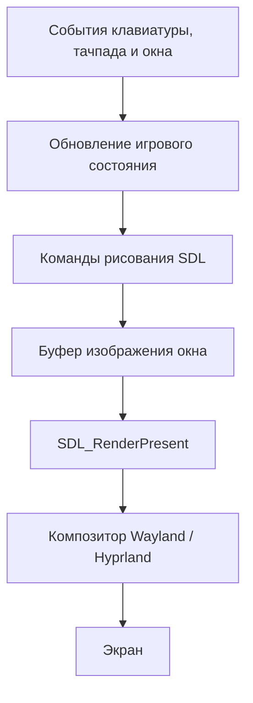

# Как устроен Ping Pong

Этот документ описывает текущую реализацию игры: какие данные она хранит, как из них получается изображение, как движутся объекты и почему выбраны именно такие решения. Формулы и численные значения соответствуют исходному коду на момент написания.

## 1. Общая идея и выбор инструментов

Игра должна быть небольшой, работать в отдельном окне под Arch Linux / Hyprland, принимать дробную прокрутку тачпада и сохранять размеры объектов при изменении окна. Для этого использованы:

| Инструмент | Его задача | Причина выбора |
|---|---|---|
| C++17 | Игровое состояние, физика, обработка событий | Позволяет собрать небольшое нативное приложение и прямо использовать SDL |
| SDL3 | Окно, Wayland, ввод, таймер, рисование, текстуры | Объединяет эти функции и предоставляет информацию о масштабе монитора |
| FreeType | Превращение символов шрифта в пиксели | Позволяет использовать настоящий шрифт Silkscreen без отдельной зависимости SDL_ttf |
| CMake | Сборка, копирование ресурсов, запуск тестов | Описывает зависимости и одинаковую процедуру сборки |
| `hyprctl` | Восстановление геометрии в Hyprland | Даёт возможность обратиться к композитору, когда обычный запрос размера SDL переопределяется тайлингом |

В проекте нет отдельного игрового движка, браузера, сцены с объектами или системы компонентов. Для двух ракеток и мяча они добавили бы больше сложности, чем пользы. Состояние хранится в обычных числах, а изображение каждый кадр строится заново.

Код разделён по ответственности:

| Файл | Содержание |
|---|---|
| `src/game.hpp` | Правила игры, движение, столкновения, счёт, боты |
| `src/main.cpp` | Окно, события, главный цикл, фигуры, текст, пауза |
| `src/settings.hpp` | Чтение и сохранение размера окна |
| `src/hyprland.hpp` | Обращение к Hyprland для восстановления размера |
| `tests/game_tests.cpp` | Проверки физики, ботов и формата настроек |
| `tests/window_persistence.cmake` | Проверка сохранения размера между двумя запусками |
| `assets/` | Шрифт Silkscreen и его лицензия |

Главное разделение: `Game` не знает о SDL, окнах и видеокарте. Поэтому физику можно проверить без открытия окна.

## 2. Как изображение попадает на экран

SDL создаёт окно через `SDL_CreateWindow`, а затем объект отрисовки через `SDL_CreateRenderer`. Окно поддерживает изменение размера и высокую плотность пикселей.

Если задан `WAYLAND_DISPLAY` и пользователь явно не выбрал другой видеодрайвер, приложение просит SDL сначала использовать Wayland, а затем X11 как запасной вариант.

Упрощённая последовательность выглядит так:



Приложение не записывает пиксели непосредственно в экран ноутбука. Оно формирует содержимое своего окна, а композитор объединяет окна рабочего стола и выводит результат на монитор.

Конкретный графический backend выбирает SDL. В коде не закреплены OpenGL или Vulkan и не написаны собственные шейдеры. При наличии подходящего backend команды обычно выполняются с аппаратным ускорением; тесты без экрана используют программную отрисовку.

В каждом кадре выполняются следующие действия:

1. `SDL_RenderClear` полностью заливает фон цветом `(29, 29, 29)`.
2. Рисуются две ракетки и мяч.
3. Поверх них выводятся счёт, сложность и, при необходимости, `AUTO`.
4. При паузе добавляется надпись или меню.
5. `SDL_RenderPresent` передаёт подготовленный кадр системе вывода.

Полная перерисовка устраняет необходимость отдельно стирать старое положение мяча. Для такой маленькой сцены это простой и подходящий вариант.

Приложение запрашивает VSync через `SDL_SetRenderVSync(renderer, 1)`, но его фактическая поддержка зависит от backend. В конце цикла есть `SDL_Delay(4)`, чтобы не крутить цикл без остановки, если синхронизация недоступна. Частота кадров при этом не является частотой игровой физики.

## 3. Координаты, масштаб и границы поля

### Три разных понятия размера

Нужно различать:

- размер окна в оконных координатах;
- размер буфера отрисовки в физических пикселях;
- размеры игрового мира в логических единицах.

Физические пиксели запрашиваются через `SDL_GetRenderOutputSize`. Масштаб содержимого окна берётся из `SDL_GetWindowDisplayScale`.

Далее используются формулы:

```text
ширина поля = ширина буфера / масштаб
высота поля = высота буфера / масштаб
```

Вызов `SDL_SetRenderScale(renderer, scale, scale)` позволяет рисовать в логических координатах: SDL сам переводит их в пиксели буфера.

Например, буфер `2200 × 1400` при масштабе `2` соответствует полю `1100 × 700`. Ракетка шириной 12 логических единиц занимает 24 физических пикселя. При увеличении окна на том же мониторе масштаб остаётся прежним, а поле становится шире или выше.

Это принципиально отличается от растягивания фиксированной сцены 960 × 600 под любое окно: здесь меняется пространство, а не размеры объектов.

Масштаб определяется по данным SDL и настройкам монитора, а не только по разрешению вроде «1920 × 1080». Одного разрешения недостаточно: экраны одинакового разрешения могут иметь разную плотность пикселей и разные настройки масштабирования.

### Система координат

Начало координат находится в левом верхнем углу клиентской области окна. `x` увеличивается вправо, `y` — вниз.

```text
(0, 0) ──────────────────────── (width, 0)
   │                                 │
   │           игровое поле          │
   │                                 │
(0, height) ───────────────── (width, height)
```

Границы поля совпадают с краями клиентской области. Рамка Hyprland и другие внешние украшения окна в поле не входят. Отдельной нарисованной рамки внутри сцены нет.

В `Game::resize` есть защитный минимум: 320 × 240 логических единиц. Окну также задаётся минимальный размер 320 × 240 в оконных координатах. В обычном используемом Wayland-режиме это согласуется; код предполагает, что фактическая область не окажется меньше игрового минимума.

### Постоянные размеры объектов

| Параметр | Значение в логических единицах |
|---|---:|
| Ширина ракетки | 12 |
| Высота ракетки | 112 |
| Отступ ракетки от ближайшей боковой границы | 38 |
| Радиус мяча | 8 |

Левая ракетка начинается на `x = 38`. Правая — на `x = width - 38 - 12`.

Вертикальные положения `player` и `bot` обозначают центры ракеток. Поэтому верхний край прямоугольника равен `center - 112 / 2`.

Функция `clampPaddle` ограничивает центр диапазоном:

```text
56 ≤ center ≤ height - 56
```

Так ракетка целиком остаётся внутри поля.

## 4. Как рисуются фигуры

### Ракетки

Каждая ракетка — `SDL_FRect`: прямоугольник с дробными координатами. Он заполняется через `SDL_RenderFillRect` цветом `(240, 240, 240)`.

Дробные координаты нужны, чтобы физика не округляла движение до целых пикселей на каждом шаге. Окончательное покрытие пикселей определяет графический backend.

### Мяч

В функции `circle` круг приближается многоугольником из 48 сегментов.

Точки на окружности вычисляются так:

```text
angle = i × 2π / 48
pointX = centerX + radius × cos(angle)
pointY = centerY + radius × sin(angle)
```

В центре находится ещё одна вершина. Центр и каждая пара соседних точек окружности образуют треугольник. Получается веер из 48 треугольников, который передаётся в `SDL_RenderGeometry`.

Для мяча радиусом 8 этого достаточно, чтобы многоугольник визуально воспринимался как круг. Текстура мячу не нужна. Собственное сглаживание контура в коде не реализовано: мелкие особенности края зависят от растеризации backend.

Внешний вид и физическая форма не обязаны использовать одинаковую реализацию: для рисования мяч — треугольники, для правил игры — центр и радиус.

## 5. Как рисуется текст

Для счёта и интерфейса используется Silkscreen. У него пиксельные, угловатые формы, подходящие под минималистичный стиль игры. Файл шрифта хранится рядом с программой в `assets`; установка шрифта в систему и интернет при запуске не требуются.

Класс `Text` выполняет такую работу:

1. Загружает файл через FreeType.
2. Рассчитывает размер шрифта в физических пикселях: `round(size × scale)`.
3. Получает ширины продвижения символов — `advance` — и складывает их.
4. Создаёт прозрачную RGBA-поверхность под строку.
5. Растеризует каждый символ в монохромном режиме `FT_LOAD_TARGET_MONO`.
6. Размещает пиксели символов на поверхности с учётом базовой линии и смещений глифа.
7. Превращает поверхность в текстуру SDL и освобождает промежуточную поверхность.
8. Рисует текстуру через `SDL_RenderTexture`.

**Глиф** — это изображение конкретного символа. **Базовая линия** — линия, относительно которой шрифт размещает буквы. **Advance** — насколько нужно передвинуть позицию перед следующим символом; это не всегда совпадает с шириной закрашенной части буквы.

Для текстуры выбран `SDL_SCALEMODE_NEAREST`, чтобы при масштабировании не размывать характерные пиксельные края. При дробном масштабе это может давать неодинаковую толщину отдельных пиксельных элементов; это компромисс в пользу резкого рисунка шрифта.

### Почему текст не создаётся заново каждый кадр

Ключ кэша состоит из строки и её размера в физических пикселях. Уже созданная строка повторно использует текстуру. При накоплении более 64 записей кэш очищается перед созданием очередной новой записи.

Серые оттенки задаются через `SDL_SetTextureColorMod`. Поэтому одной текстуры достаточно для вывода строки разными оттенками.

Для центрирования вычисляется:

```text
left = centerX - textureWidth / scale / 2
```

Текущий обработчик текста проходит по байтам строки и рассчитан на используемые ASCII-подписи. Он не является полноценным Unicode-движком: для русского интерфейса понадобятся декодирование UTF-8 и подходящий шрифт, а для сложных письменностей — ещё и формирование текста.

## 6. Главный цикл и независимость физики от FPS

Если двигать мяч на одинаковое расстояние за каждый кадр, на мониторе 144 Гц игра будет быстрее, чем на 60 Гц. Поэтому движение рассчитывается по времени.

Физический шаг постоянный:

```text
dt = 1 / 240 секунды ≈ 4,17 мс
```

Реальное время измеряется через `SDL_GetTicksNS`. В главном цикле оно складывается в аккумулятор:

```text
accumulator += elapsed

пока accumulator >= 1/240:
    выполнить Game::step(1/240)
    accumulator -= 1/240
```

Один кадр может содержать несколько шагов физики. Отрисовка показывает последнее рассчитанное состояние. Интерполяции между физическими состояниями сейчас нет.

Время одного прохода ограничивается сверху 0,05 секунды. Если программа надолго задержалась, она не пытается немедленно просчитать весь пропуск. Это предотвращает длинную цепочку догоняющих обновлений, но означает, что при больших задержках часть реального времени намеренно отбрасывается.

## 7. Движение мяча, стенки и голы

Состояние мяча состоит из четырёх основных величин:

```text
x, y    — координаты центра
vx, vy  — скорость по горизонтали и вертикали
```

Скорости измеряются в логических единицах в секунду. На каждом физическом шаге:

```text
x = x + vx × dt
y = y + vy × dt
```

Во время свободного полёта нет гравитации, сопротивления воздуха или ускорения. Между столкновениями скорость постоянна.

### Верхняя и нижняя стенки

Мяч имеет радиус `r = 8`, поэтому его центр должен находиться между `r` и `height - r`.

Если после шага `y < r`, выполняется:

```text
y = 2 × r - y
vy = abs(vy)
```

Если `y > height - r`:

```text
y = 2 × (height - r) - y
vy = -abs(vy)
```

Координата отражается относительно линии касания. Например, если центр проник на 2 единицы за разрешённую границу, после коррекции он окажется на 2 единицы внутри поля. Это сохраняет небольшой остаток пройденного пути, а не просто прижимает мяч к стенке.

Горизонтальная составляющая скорости при таком отскоке не меняется. Вертикальная меняет знак; её модуль сохраняется.

### Гол

Гол засчитывается при касании окружностью бокового края:

```text
x <= r          → очко правой стороне
x >= width - r  → очко левой стороне
```

Не требуется ждать, пока центр или весь мяч выйдет за окно.

После гола `serve` переносит мяч в центр и задерживает новую подачу на 0,75 секунды. Ракетки в это время могут двигаться. Начальная скорость равна 370, угол выбирается случайно в диапазоне от −0,48 до +0,48 радиана.

При полном сбросе направление подачи случайное. После гола подача направляется в сторону того края, где был пропущен мяч. Счёт не ограничен заранее заданным числом очков: отдельного состояния «матч завершён» нет.

## 8. Как определяется попадание в ракетку

Для столкновений проверяется не только текущее положение, но и предыдущая координата `oldX`. Это позволяет заметить, что мяч пересёк поверхность ракетки между двумя шагами.

### Левая ракетка

Её обращённая в поле грань находится на:

```text
38 + 12 = 50
```

Центр мяча касается этой грани, находясь на расстоянии радиуса справа:

```text
leftFace = 38 + 12 + 8 = 58
```

Для отскока одновременно должны выполняться условия:

```text
vx < 0                         мяч летит влево
oldX >= leftFace               до шага он был со стороны поля
x <= leftFace                  после шага пересёк линию касания
abs(y - player) <= 56 + 8       по вертикали достаёт до ракетки
```

Для правой стороны всё зеркально: направление скорости положительное, а линия касания равна `width - 38 - 12 - 8`.

Проверка направления и пересечения предотвращает повторные отскоки от одной грани, когда мяч уже улетает от неё. После попадания центр устанавливается на линию касания и вызывается `bounce`.

### Как выбирается направление отскока

Вычисляется нормированное смещение точки попадания относительно центра ракетки:

```text
offset = clamp((ballY - paddleCenter) / 64, -1, 1)
angle = offset × 1,05
```

Попадание в центр даёт горизонтальный полёт. Верхняя часть ракетки отправляет мяч вверх, нижняя — вниз. Предельный угол составляет примерно 60 градусов к горизонтали. Это делает выбор места удара частью игры и не позволяет мячу стать почти вертикальным.

После каждого попадания скорость растёт на 4,5%, но не превышает 780:

```text
speed = min(780, sqrt(vx² + vy²) × 1,045)
vx = direction × speed × cos(angle)
vy = speed × sin(angle)
```

`direction` равен `+1` после левой ракетки и `−1` после правой.

Это аркадная модель: угол определяется местом попадания, а не физическим законом столкновения двух тел. Скорость ракетки не добавляет мячу вращение или дополнительный импульс.

### Насколько точна проверка

На максимальной скорости мяч проходит за шаг примерно `780 / 240 = 3,25` единицы. В сочетании с проверкой пересечения этого достаточно для текущей игры.

Но это не полноценное непрерывное столкновение окружности и движущегося прямоугольника. Вертикальное попадание проверяется в конце шага; возле углов используется расширенный вертикальный диапазон, поэтому углы немного более «прощающе» ловят мяч, чем точная геометрия окружности. После удара о ракетку остаток движения внутри шага не досчитывается.

Для очень высоких скоростей или более сложных препятствий понадобился бы расчёт точного времени столкновения и движения на оставшуюся часть шага.

## 9. Управление игроком через тачпад

`SDL_EVENT_MOUSE_WHEEL` передаёт вертикальную прокрутку в `event.wheel.y`. Она остаётся дробной: маленькие движения тачпада не округляются до целых шагов.

Прокрутка меняет желаемую позицию:

```text
target = clampPaddle(target - scrollAmount × 38)
```

Настоящее положение ракетки приближается к ней постепенно:

```text
player += (target - player) × (1 - exp(-28 × dt))
```

Это экспоненциальное сглаживание: чем дальше цель, тем больше перемещение; по мере приближения движение замедляется. Зависимость от `dt` делает сглаживание практически одинаковым при разной частоте обновлений.

Здесь не хранится отдельная скорость игрока. Это более прямое и отзывчивое управление, чем инерционная модель бота. Коэффициент 28 соответствует характерному времени около 36 мс; примерно за 107 мс ракетка проходит 95% расстояния до неизменной цели.

Приложение использует направление прокрутки, пришедшее от SDL, без дополнительного разворота признака natural scrolling. В ручной паузе, без фокуса или при сворачивании прокрутка не меняет цель. Во время паузы изменения размера цель может обновляться, но физическое движение ждёт продолжения игры.

## 10. Как бот выбирает цель

Бот не использует нейросеть или обучение. Это небольшой алгоритм с ограниченными реакцией, скоростью, ускорением и точностью.

Для каждой ракетки под управлением бота есть собственные:

- таймер следующего пересчёта цели;
- целевая вертикальная координата;
- текущая вертикальная скорость;
- ошибка прицеливания;
- признак того, что мяч сейчас подлетает к этой стороне.

| Сложность | Интервал пересчёта цели | Ошибка прицеливания | Максимальная скорость | Максимальное ускорение |
|---|---:|---:|---:|---:|
| 1 — лёгкая | 0,26 с | ±65 | 210 ед./с | 1000 ед./с² |
| 2 — средняя | 0,13 с | ±28 | 330 ед./с | 1500 ед./с² |
| 3 — сложная | 0,055 с | ±9 | 490 ед./с | 2200 ед./с² |

Если мяч летит от ракетки или ещё ожидает подачи, цель — середина поля. Если он подлетает, лёгкий бот ориентируется на текущую высоту мяча, а средний и сложный рассчитывают высоту будущей встречи с учётом отскоков от стенок.

Интервал реакции означает именно период обновления цели. Это не отдельная задержка каждого движения: уже выбранную цель бот продолжает преследовать на каждом шаге физики. Поэтому сложность не превращает его движение в редкие скачки.

### Предсказание отскоков

Сначала вычисляется время до линии касания ракетки:

```text
t = max(0, (faceX - ballX) / vx)
```

У левой стороны и расстояние, и скорость отрицательные, поэтому время остаётся положительным. Для почти нулевого `vx` предусмотрена защита от деления.

Затем нужно узнать, где будет мяч по вертикали после возможных отражений. Вместо перебора стенок используется «развёрнутое» поле:

```text
span = height - 2 × radius
p = (y - radius + vy × t) mod (2 × span)
если p < 0: p += 2 × span

если p <= span: результат = radius + p
иначе:         результат = radius + 2 × span - p
```

Это треугольная волна: первая половина периода идёт от верхней границы к нижней, вторая возвращается обратно. Она описывает любое число отражений между двумя горизонтальными стенками.

Бот знает текущее состояние мяча точно, а «человечность» создаётся ограничениями и добавленной ошибкой. Предсказание предполагает неизменную скорость на оставшемся пути до своей ракетки; отражения от горизонтальных стенок этому предположению не мешают.

### Почему исчезло дрожание

Раньше случайная ошибка выбиралась при каждом пересчёте цели. Даже если идеальная точка встречи не менялась, новая цель оказывалась то выше, то ниже. Ракетка постоянно разворачивалась.

Теперь ошибка выбирается один раз при переходе к входящему полёту и остаётся постоянной на протяжении этого подлёта. При ожидании в центре ошибка вообще не добавляется.

Смена сложности сбрасывает признак отслеживания, поэтому новая ошибка будет выбрана уже по диапазону нового уровня. У двух ботов одинаковые правила, но независимое состояние: их случайные ошибки не обязаны совпадать.

## 11. Как бот плавно разгоняется и тормозит

Одной стабильной цели недостаточно: если мгновенно назначать максимальную скорость вверх или вниз, развороты всё равно будут резкими. Поэтому бот хранит скорость и изменяет её через ускорение.

Основа — модель пружины с демпфированием:

```text
distance = target - position
acceleration = 81 × distance - 18 × velocity
```

Первое слагаемое тянет ракетку к цели. Второе сопротивляется текущему движению и позволяет затормозить заранее.

Числа связаны: `81 = 9²`, а `18 = 2 × 9`. Для непрерывной линейной модели с единичной массой это критическое демпфирование — быстрое приближение к неподвижной цели без затухающих колебаний вокруг неё.

В игре дополнительно используются дискретные шаги и ограничения скорости и ускорения. Поэтому термин описывает основу модели, а не математическую гарантию отсутствия любого перелёта при любых переключениях цели.

На каждом шаге выполняется:

```text
acceleration = clamp(acceleration, -maxAcceleration, maxAcceleration)
velocity += acceleration × dt
velocity = clamp(velocity, -maxSpeed, maxSpeed)
position += velocity × dt
```

Например, средний бот может изменить скорость за один шаг не более чем примерно на `1500 / 240 = 6,25` ед./с, пока не вступают в действие специальные ограничения. Из состояния покоя он не получает скорость 330 мгновенно.

Когда цель далеко, ракетка разгоняется. Когда расстояние уменьшается, сила притяжения ослабевает, а тормозящее слагаемое остаётся — скорость падает. При смене направления ракетке сначала нужно погасить уже имеющуюся скорость.

Вблизи цели действует небольшой порог:

```text
если abs(distance) < 0,1 и abs(velocity) < 1:
    velocity = 0
```

Он прекращает бессмысленные микродвижения. Координата при этом не телепортируется точно в цель: допускается ошибка менее 0,1 единицы.

При упоре в край поля скорость обнуляется. При изменении размера окна скорости ботов также сбрасываются, чтобы после переноса объектов внутрь нового поля не осталось неподходящей инерции. При снижении сложности новый предел скорости применяется сразу; это отдельный случай, где скорость может измениться сильнее обычного ограничения ускорения.

## 12. Автоматический режим, сложность и сброс

По `A` меняется флаг `automatic`. В автоматическом режиме левая ракетка вызывает тот же `moveBot`, что и правая, но с зеркальной стороной поля и собственным состоянием движения. Обе стороны используют одно значение `difficulty`.

Прокрутка при включённом `AUTO` игнорируется. При переключении режимов цель ручного управления устанавливается в текущее положение ракетки, а состояние её бота сбрасывается. Поэтому возвращение к ручному управлению не отправляет ракетку к старой забытой цели.

Клавиши `1–3` меняют только сложность и состояние пересчёта целей. Координаты мяча, счёт и текущий розыгрыш сохраняются.

`R` обнуляет счёт, возвращает ракетки в центр и готовит новую подачу. Сложность и автоматический режим сохраняются. Если `R` нажат в меню паузы, игра остаётся на паузе до `Esc`.

Клавиши обрабатываются по `scancode`, то есть по физическому расположению, а не по символу текущей раскладки. Повторные события удерживаемой клавиши игнорируются: это особенно важно для переключателей `A` и `Esc`.

## 13. Пауза и изменение размера окна

Итоговый признак паузы объединяет четыре причины:

```text
manualPause ИЛИ resizePause ИЛИ отсутствие фокуса ИЛИ сворачивание
```

Во время паузы физика не обновляется, но цикл событий и отрисовка продолжают работать. Аккумулятор физического времени очищается, поэтому после возвращения игра не пытается «догнать» время паузы.

`Esc` переключает ручную паузу. При переключении также сбрасывается время текущего кадра. Выход из меню не отменяет другие причины паузы: например, незавершённое изменение размера.

### Пауза при растягивании

Каждое событие размера окна, размера буфера или изменения масштаба:

1. Обновляет масштаб и размеры поля.
2. Ограничивает положения объектов новыми границами.
3. Устанавливает `resizeUntil = now + 0,18`.

Пока новые события продолжают приходить, этот срок отодвигается. Через 180 мс тишины симуляция продолжается.

Это эвристика, а не точное определение отпускания кнопки мыши. Если пользователь остановит перетаскивание, но продолжит удерживать кнопку без изменения размера, игра тоже сможет продолжиться.

При сужении поля мяч ограничивается по горизонтали диапазоном от `radius + 1` до `width - radius - 1`. Дополнительная единица оставляет его внутри линии гола. Поэтому само уменьшение окна не начисляет очко. Во время ожидания подачи мяч заново центрируется.

### Вид паузы

Автоматическая пауза показывает серую надпись `PAUSED`. Ручная использует тот же фон и спокойные серые оттенки, но добавляет подсказки клавиш.

Под меню рисуется прямоугольник цвета фона. Он закрывает мяч или другую фигуру непосредственно под текстом, чтобы подписи не накладывались на них. Это только визуальная подложка, игровое состояние она не меняет.

## 14. Скрытие курсора

При входе указателя в окно приходит `SDL_EVENT_WINDOW_MOUSE_ENTER`, и вызывается `SDL_HideCursor`. При выходе — `SDL_ShowCursor`.

Курсор также восстанавливается при потере фокуса и перед завершением программы. При возврате фокуса он снова скрывается, если находится над окном. Захвата мыши и относительного режима ввода здесь нет: указатель может свободно покинуть игру.

## 15. Сохранение размера и особенности Hyprland

### Что сохраняется

Сохраняются ширина и высота окна в оконных координатах, а не физический размер буфера. Например, при масштабе 200% размер окна 1100 × 700 не должен ошибочно превратиться в 2200 × 1400 при следующем запуске.

Настройки лежат в каталоге, который возвращает `SDL_GetPrefPath("ping-pong", "ping-pong")`. Типичный путь Linux:

```text
~/.local/share/ping-pong/ping-pong/window-size.txt
```

Формат текущей версии:

```text
1100 700 2
```

Последнее число — версия формата. Размеры проверяются: ширина не меньше 320, высота не меньше 240, оба значения не больше 16384.

Старый файл из двух чисел тоже читается. Для старого значения `320 240`, оставшегося после ошибочного восстановления, есть специальная миграция к базовым 960 × 600. В формате версии 2 минимальный размер можно сохранять намеренно.

### Почему изменился способ записи

Первая реализация запрашивала геометрию непосредственно при выходе. В диагностике выяснилось, что в файле оставался минимум 320 × 240, а Hyprland действительно назначал такой размер при отображении окна. Одного успешного чтения и записи файла оказалось недостаточно для проверки восстановления.

Теперь размер берётся из `SDL_EVENT_WINDOW_RESIZED`, пока окно работает. Изменённые значения записываются после окончания паузы растягивания; при обычном выходе сохраняются оставшиеся изменения. Поздние события после команды выхода не должны перезаписывать кэш.

Запись выполняется во временный файл, затем он заменяет основной через `rename`. Читатель не должен увидеть наполовину записанные числа. Это не полная гарантия сохранности при отключении питания: принудительного `fsync` в реализации нет.

### Почему пришлось обращаться к композитору

В Wayland окончательную геометрию определяет композитор. На используемой системе запрос `SDL_SetWindowSize` не обеспечивал желаемый размер в тайлинге. Это было видно и по событиям протокола, и по фактическому размеру окна.

Текущая последовательность запуска:

1. Прочитать сохранённый размер.
2. Создать скрытое окно и задать минимальные ограничения.
3. Показать окно и синхронизировать его состояние.
4. Создать renderer и представить первый буфер.
5. Повторить обычный запрос размера SDL.
6. В Hyprland перевести только окно игры в floating и запросить нужный размер через `hyprctl`.

Обращение к Hyprland выполняется только под Linux, при наличии `HYPRLAND_INSTANCE_SIGNATURE` и видеодрайвера `wayland`. Используется selector `pid:<PID игры>`, поэтому команда не зависит от того, какое окно сейчас активно.

Для текущего Lua-интерфейса команды имеют вид:

```lua
hl.dsp.window.float({action='enable', window='pid:12345'})
hl.dsp.window.resize({x=1100, y=700, relative=false, window='pid:12345'})
```

Они отправляются через `hyprctl --batch` как аргумент процесса SDL, без запуска shell. Числа формируются самой программой. Параметр `enable` существенен: при проверке устаревший вариант `set` не давал нужного плавающего режима.

Ожидание процесса ограничено примерно 1,5 секунды; затем ещё до 0,5 секунды проверяется получение нужного размера SDL. При неудаче игра продолжает запуск с фактически назначенной геометрией. Автоматического перехода на старый синтаксис Hyprland сейчас нет.

Этот механизм намеренно восстанавливает размер через floating. Состояние тайлинга, позиция окна, монитор и полноэкранный режим не сохраняются. Пользователь может вручную вернуть окно в тайлинг, но следующий обычный запуск снова запросит floating.

## 16. Как проверяются решения

Проверки разделены по тому, что именно они могут подтвердить.

**Проверки модели без окна** проверяют голы у двух границ, отскок на большой скорости, отражение от верхней стенки, сохранение розыгрыша при смене сложности, сброс, дробную прокрутку, уменьшение поля без гола и длительную симуляцию.

Для ботов отдельно проверяются зеркальная эквивалентность алгоритма двух сторон при одинаковом случайном seed, ограничение изменения скорости в выбранном сценарии, остановка в центре и постоянство ошибки прицеливания на одном подлёте.

**Проверка событий SDL** программно отправляет нажатия клавиш и прокрутку, меняет размер, проверяет паузу, переключение `AUTO` и выход. В CTest используется видеодрайвер `dummy`, поэтому настоящего окна не требуется.

**Проверка сохранения** использует отдельный файл и два запуска приложения: сначала восстанавливает 1234 × 789, затем меняет размер на 1100 × 700, проверяет записанный файл и запускает игру снова с ожиданием 1100 × 700. Пользовательские настройки этот тест не изменяет.

Отдельно этот сценарий был выполнен в настоящем Wayland-сеансе Hyprland с масштабом 200%: буфер обоих запусков после изменения имел размер 2200 × 1400, соответствующий оконным 1100 × 700.

Это важное различие: тест чтения чисел подтверждает формат файла, а тест двух реальных окон — взаимодействие с композитором. Один не заменяет другой.

## 17. Где менять поведение

| Желаемое изменение | Место в коде |
|---|---|
| Размеры ракеток и мяча | Константы в начале `Game` |
| Чувствительность прокрутки | Множитель 38 в `scroll` |
| Плавность ручного управления | Коэффициент 28 в `step` |
| Начальная скорость мяча и задержка подачи | `serve` |
| Ускорение мяча, предел скорости, угол отскока | `bounce` |
| Реакция и точность ботов | Массивы `reaction` и `error` в `moveBot` |
| Предельная скорость и ускорение ботов | `maxSpeed` и `maxAcceleration` |
| Характер торможения бота | Формула `81 × distance - 18 × velocity` |
| Время паузы после изменения окна | `resizeUntil = now + .18` в `main.cpp` |
| Цвета, расположение счёта и меню | Блок отрисовки в главном цикле |
| Размер по умолчанию и формат настроек | `WindowSize` |
| Взаимодействие с Hyprland | `restoreHyprlandSize` |

Если менять размер мяча, ракеток, максимальную скорость или частоту физики, стоит повторно проверить столкновения: их надёжность зависит от расстояния, которое мяч проходит за один шаг.

Основной принцип проекта — сохранять простые правила и отделять их от особенностей графики и оконной системы. Движение и счёт остаются обычной математической моделью; SDL отвечает за ввод и изображение, а отдельный небольшой адаптер решает специфичную для Hyprland задачу восстановления окна.

## 18. Перенос на macOS

На macOS используется та же модель `Game`. Платформенные изменения касаются
обвязки: включён `SDL_main.h`, выбор Wayland ограничен Linux, а CMake создаёт
`Ping Pong.app`. Файл `Info.plist` включает поддержку Retina и указывает SDL
использовать `Contents/Resources` как базовый каталог ресурсов. Шрифт и его
лицензия копируются в `Resources/assets`, поэтому запуск из Finder не зависит
от текущей рабочей папки.

Для Mac по умолчанию включена опция `PING_PONG_BUNDLED_DEPS`: SDL 3.4.0 и
FreeType 2.14.1 скачиваются с проверкой SHA-256 и линкуются статически.
На Linux по умолчанию остаются системные библиотеки. При упаковке проверяется,
что приложение не ссылается на библиотеки Homebrew или каталоги сборщика.
Скрипт создаёт ad-hoc подпись и ZIP, но не выполняет Apple notarization.

GitHub Actions собирает обе архитектуры на macOS 15: arm64 и x86_64.
Кроме обычных CTest-проверок выполняется запуск нативного Cocoa-окна и
перемещённой копии готового приложения. Синтетический ввод не подтверждает
удобство настоящего тачпада: список ручных проверок приведён в MACOS.md.
